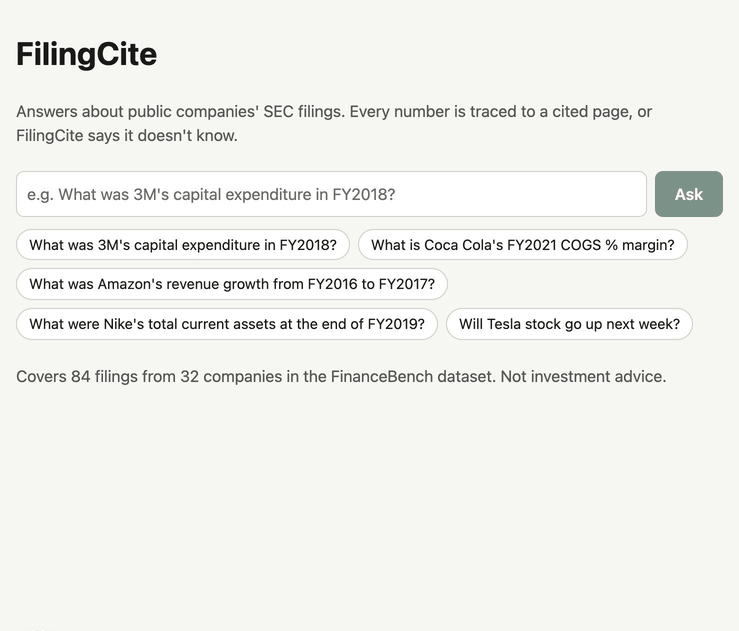

# FilingCite

[](https://github.com/BhavnoorSaini/FilingCite/actions/workflows/ci.yml)

Ask questions about public companies' SEC filings. Every number in an answer is traced to a
cited page, or FilingCite says "I don't know".

AI models invent numbers, and in finance one wrong figure makes an answer worthless. So the
model may only quote numbers that are on the pages it cites, and it never does arithmetic: it
names the calculation and Python does it.

Live: [filingcite.vercel.app](https://filingcite.vercel.app)



## Scorecard

The 150 [FinanceBench](https://github.com/patronus-ai/financebench) open-source questions plus
15 that should be refused, graded by Python ([full results](backend/evals/results/full.md)):

| Metric | Result |
| --- | --- |
| Found the right page | 94/150 (63%) |
| Answered correctly (numeric answers within 1%) | 42/54 (78%) |
| Refused correctly | 15/15 (100%) |
| Blocked a number | 4 |

Only the 54 short numeric answers are graded; the 96 written ones need judgement.

| Number check | Off | On |
| --- | --- | --- |
| Questions answered | 100 | 97 |
| Numeric answers correct | 42 | 42 |
| Numeric answers wrong | 5 | 4 |

The model rarely invents a figure outright, so the check mostly guarantees that every number
shown is traceable. None of the four answers it blocked was a correct numeric answer.

## How it works

1. **Ingest, once on a Mac** ([backend/ingest](backend/ingest)): Docling reads each PDF into
   text and tables with page numbers. Text becomes ~300-word chunks that never cross a page;
   tables stay whole. FastEmbed (bge-small-en-v1.5) embeds them into Neon Postgres with pgvector.
2. **Retrieve** ([retrieval.py](backend/retrieval.py)): search the filings of the company and
   year the question names. If it names a financial statement or a line item on one, put that
   statement's table first, then the closest chunks by meaning.
3. **Draft** ([llm.py](backend/llm.py)): if even the best chunk is a weak match, refuse.
   Otherwise gpt-oss-120b on Groq replies in strict JSON: the answer, the excerpts it cites, the
   numbers it used, and any calculations.
4. **Check** ([answer.py](backend/answer.py)): refuse if the reply is malformed, cites an
   excerpt it wasn't given, or uses a number that isn't on a cited page. Python runs the
   calculations and fills in the results.

## Quickstart

Needs Python 3.12 with uv, Node with pnpm, the Vercel CLI, a Neon database, a Groq API key and
a clone of the FinanceBench repo.

```bash
cp .env.example .env   # fill in DATABASE_URL, LLM_API_KEY and FINANCEBENCH_DIR
cd backend
uv sync
uv run --env-file ../.env python -m scripts.init_db
uv run --group ingest --env-file ../.env python -m ingest.load   # takes hours; resumable
cd ../frontend && pnpm install && cd ..
vercel dev   # http://localhost:3000
```

Tests (fake model, no network) and the eval (resumable):

```bash
cd backend
uv run pytest
uv run --env-file ../.env python -m evals.run --set full --name full
uv run --env-file ../.env python -m evals.score --name full
```

## Cuts

No stock predictions or investment advice, live prices, comparisons across companies, user
uploads, accounts, or filings outside FinanceBench.

## Known limits

- Retrieval misses 37% of evidence pages, mostly for narrative questions answered in long
  MD&A text.
- The number check can't catch a wrong choice of real numbers, or answers with no numbers.
- Companies are matched by name, so tickers like "JPM" search every filing.
- Zero is always blocked, since filings print a dash instead.
- The live site uses Groq's free tier, so it can fail under load.

## Three real wrong answers

1. **PepsiCo's credit facility increase: $750 million (expected $400 million).** The 8-K says
   a new $4.2 billion facility *may later be increased* to $4.95 billion. The model subtracted
   the two, mistaking an optional upsize for the actual change, on the wrong facility.
2. **Pfizer's remaining Upjohn spin-off cost: $700 million (expected $77.78 million).**
   Retrieval returned the 2021 10-K instead of the 2023 10-Q, and the model quoted the total
   cost rather than what was left to pay.
3. **Walmart's 3-year average EBITDA margin: 6.02% (expected 6.2%), blocked.** The model got
   each year's margin right, then averaged the wrong results and gave one year's margin. It
   had copied its own sums (like 31,555) as if they were on a page, so the number check
   refused the answer.
